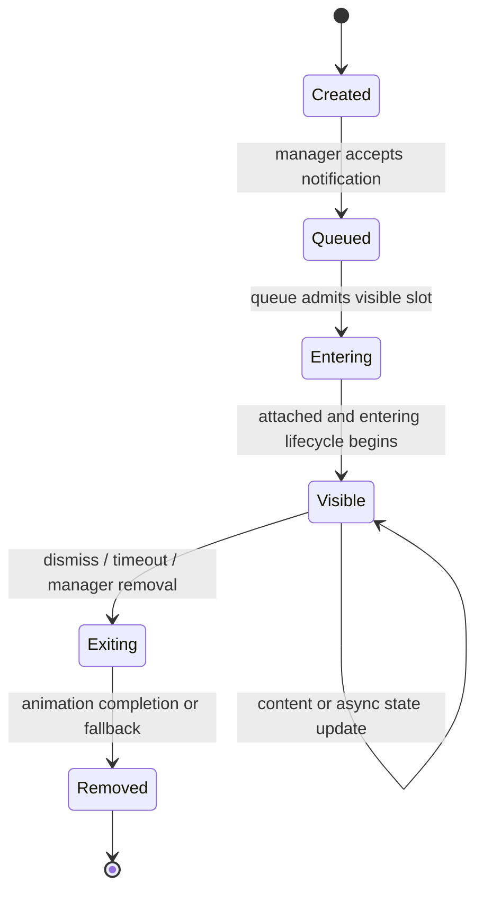

# Runtime Data Model — Toast-JS

**Scope:** In-memory runtime model only. Toast-JS does not require a database or persistent storage for notifications.

## 1. Notification

Represents one logical notification across its queued, visible, updated, and removed lifetime.

| Conceptual field | Meaning | Constraint |
|---|---|---|
| `id` | Stable identity for update/dismiss operations | Unique among live notifications managed by the relevant manager. |
| `content` | Message content accepted by the public API | Rendering/escaping behavior must follow the existing public contract and security rules. |
| `mode` | Transient, persistent, actionable, or async | Mode controls timer/action/state behavior, not a separate product type. |
| `position` | Display position | Determines the independent queue. |
| `duration` | Configured visible duration | Does not count time waiting in the queue. |
| `style` | Preset or consumer customization | Must preserve existing preset objects and aliases. |
| `actions` | Optional action definitions | Each action requires a documented accessible name and execution contract. |
| `lifecycleState` | Created/queued/entering/visible/exiting/removed | One lifecycle state at a time. |
| `operationState` | Optional async state: idle/pending/succeeded/failed | Orthogonal to display lifecycle. |

Exact public field names and API signatures are not prescribed here.

## 2. Position Queue

A queue is scoped to one display position.

| Concept | Meaning |
|---|---|
| `position` | Queue ownership key. |
| `visibleLimit` | Configured simultaneous visible limit; defaults to 3 independently for each position. |
| `visibleItems` | Notifications that have acquired a visible slot. |
| `pendingItems` | FIFO-ordered notifications waiting for a slot. |
| `sequence` | Enqueue order used to preserve FIFO semantics. |

**Invariants:**

- One position cannot consume another position's capacity.
- Pending notifications do not start their visible-duration timer.
- A slot remains accounted for while its notification is entering, visible, paused, or exiting.
- The next pending item is admitted only after the previous visible item has been removed (including its exit completion/fallback).
- No priority queue is part of the initial design.

## 3. Timer State

Each transient notification has an independent timer state.

| Concept | Meaning |
|---|---|
| `configuredDuration` | Initial or most recently configured duration. |
| `remainingDuration` | Time still available when paused/resumed. |
| `deadline` | Time at which the current active interval expires, if running. |
| `pauseReasons` | Set of independent reasons such as `hover`, `focus`, and `action`. |
| `timerState` | Not-started, running, paused, expired, or cleared. |

**Invariants:**

- Timer starts when the notification becomes visible, not when it is enqueued.
- Adding a pause reason while already paused does not overwrite other reasons.
- Clearing one pause reason does not resume while another reason remains.
- Action settlement clears only the action pause reason; the remaining duration resumes when no pause reasons remain.
- Persistent notifications do not receive an automatic dismissal timer.
- Permanent removal clears timer resources.

## 4. Action Execution

Represents one user-triggered action associated with a notification.

| Concept | Meaning |
|---|---|
| `actionId` | Stable identity within the notification where needed. |
| `label` | Accessible action name. |
| `executionState` | Idle, running, fulfilled, or rejected. |
| `result` | Optional consumer-defined result; not rendered as arbitrary HTML by default. |

When execution starts, the notification's timer is paused for the `action` reason. On either success or failure settlement, the action pause reason is cleared and remaining duration resumes unless another pause reason remains. Whether an action changes notification content is controlled by the notification update contract, not by the timer.

## 5. Async Operation State

Async operation state is separate from display lifecycle:

```text
idle -> pending -> succeeded
                 -> failed
```

The same notification identity may represent the operation throughout the transition. A consumer can update the notification by ID. The spec requires documented settlement behavior; the exact option names and signatures are defined in the public API design, not invented in this model.

## 6. Rendered Notification

A rendered notification is the DOM representation owned by `DOMRenderer`.

- The renderer owns element creation, updates, attachment, removal, and rendering-related accessibility attributes.
- The renderer does not own queue policy, timer state, or the manager's active-notification registry.
- The renderer reports exit completion or cancellation to the lifecycle coordinator.
- The manager/queue releases visible capacity after completed removal or bounded fallback.
- Runtime stylesheet resources must have explicit ownership and cleanup when injection is used.

## 7. Lifecycle



Timer pause reasons and action/async operation state are orthogonal state dimensions. They must not be represented as competing values in the main display lifecycle enum.

## 8. Open Design Details

These are implementation design items, not user-facing decisions:

- Whether a lightweight value object is needed for queue entries or the manager can hold notification references directly.
- Whether event subscription logic deserves a separate internal class or remains private within `Toast`.
- The exact policy when a consumer changes duration while a notification is paused or an action is running.
- How to handle a renderer failure after a slot has been reserved without leaking capacity.
- How an async action that never settles is represented and whether consumers can cancel it.

Resolve these through contract design and tests. Do not introduce extra domain classes unless they materially simplify ownership or invariants.
